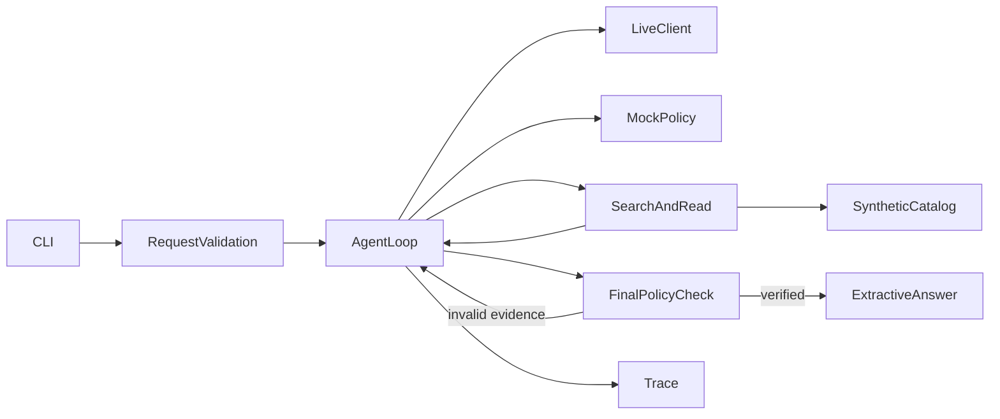

# 技术方案

Python标准库HTTP/JSON/CLI；pytest测试。models规范化与输入校验，tools检索及读取状态，policy主题、覆盖和引用校验，agent原生循环，llm_client真实模型适配，mock_policy独立确定性测试策略。

工具返回ok/data/error。search_documents提供候选元数据与has_more；read_fragment强制先检索再读取，内容带SHA-256。主题别名按NFKC/大小写/空白归一化匹配，支持简单中英文同义表达和精确文档ID。不是通用语义检索器。

上下文只在当前问题是追问且无明确新主题时使用最近一条user问题；不会从assistant回答建立事实，也不会越过最新无关user话题去找更老的制度。最终相关范围由服务端固定主题表解析，避免模型任意检索一个无关文档后答非所问。

Policy结束校验会查看当前库里所有相关topic片段的ID，要求模型实际读取全部相关变体，防止top-k遮住D02。缺片段时返回INCOMPLETE_EVIDENCE，模型可补查/读取。冲突依据为同主题原文归一化后存在不同文本，保守要求人工确认；不将此机制包装成通用语义矛盾识别。scope/priority作为引用元数据保留，不自动推断覆盖关系或以新版本覆盖旧制度。

模型finalize只提出mode和精确引用，服务端校验每个ID、相关性及完整原文相等；拒绝截断条件、篡改数字或未读取引用。真正回答由已核验原文组成，不采信模型自由文本。对冲突要求引用各方，并由应用生成中性澄清问题。工具错误与资料不存在分开；预算耗尽返回incomplete并保留已读原文，不伪装完成。

原生循环把工具观察（包括结束校验失败）写回role=tool，再请求模型选下一步。单工具约束、最大12轮/10工具及最多两次模型错误都有硬上限。Trace的next_action来自后续实际动作，不预填；仅记录公开短理由，禁止隐藏推理和密钥。mock与live模式分开。
